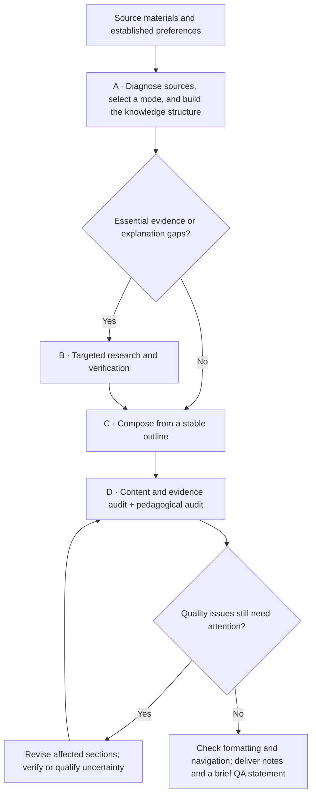
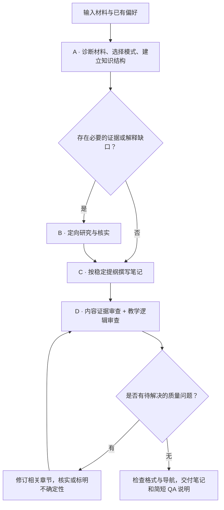

# Adaptive Academic Note Architect v2.0

[English](#english) | [Chinese version](#chinese-version)

<a name="english"></a>

**Transform slides, lecture transcripts, handwritten notes, and personal notes into comprehensive, trustworthy, coherent study notes that can be understood on their own.**

A Codex skill for comprehensive, coherent, evidence-grounded academic notes, with adaptive processing and compact bilingual output.

The goal is to preserve every recoverable, meaningful piece of information in the supplied materials while improving understanding through knowledge reconstruction, necessary explanations, and source verification. Conciseness comes from removing repetition and redundant wording.

## 1. Core Capabilities

| Capability | Problem addressed and behavior |
|---|---|
| **Complete coverage and source integration** | Integrates slides, transcripts, handwritten notes, and personal notes into one set of notes. Preserves meaningful explanations, equations, derivations, case details, qualifications, classroom questions, exercises, and course information. Merges only genuine duplicates, removes verbal filler, and retains necessary uncertainty. |
| **Knowledge architecture** | Reorganizes content around conceptual dependencies, making prerequisites, motivation, mechanisms, and applicability explicit. The structure adapts to the subject: for example, definitions → theorems → proofs → applications in mathematics, or problems → solutions → implementation → evaluation in engineering. |
| **Self-contained conceptual explanations** | Explains **What, Why, How, When, and Connections** where needed. Fills essential background, reasoning steps, and transitions while preserving equations, variable meanings, assumptions, and derivations. These questions guide explanations without forcing five subsections for every concept. |
| **Corrections and evidence management** | Cross-checks terminology, equations, numbers, and transcription ambiguities. Distinguishes source content, evidence-backed corrections, grounded explanations, external additions, and unverified information. Substantive external facts require reliable citations; teachers' opinions and industry experience retain their attribution. |
| **Information separation** | Separates core knowledge, company and practical experience, and course administration. Includes exercises, corrections, and references when present, without turning anecdotes into universal claims or creating empty sections. |
| **Two-pass quality assurance** | Reviews content coverage and evidence separately from prerequisites, explanations, transitions, headings, and readability. Prioritizes issues by risk and revises the affected passages or sections. |

## 2. Reading and Workflow Support

| Feature | Default behavior |
|---|---|
| **Bilingual writing and consistent terminology** | Uses Chinese explanations with English technical terminology. Introduces important terms with the relevant Chinese name, English name, and abbreviation. English-only or other bilingual arrangements can be requested. |
| **Underlined takeaways** | Selects a conclusion or summary clause representing each substantive paragraph or coherent fragment, usually one span and occasionally two. Preserves qualifications and uncertainty; avoids underlining entire paragraphs or every technical term. |
| **Contents and navigation** | Uses descriptive headings, decides whether to include a table of contents from the actual rendered page count, and checks final page numbers and links. |
| **Compact, readable layout** | Reduces unnecessary line breaks and repeated wording. Uses clear heading levels, spacing, tables, and equations; selects fonts supporting Chinese and English in the actual environment and checks their rendering. |
| **Incremental edits and content protection** | For later font, TOC, or underline changes, edits the latest accepted document, preserves text and equations, and verifies the affected formatting and navigation. |
| **Reusable automation** | Provides scripts for text extraction, cache reuse, exact underline application, and structural checks. Codex performs semantic judgment and composition. |

**The TOC policy uses the final rendered page count of the delivered document, including the TOC, front matter, and references:**

| Page count | Default TOC policy |
|---|---|
| **More than 10 pages** | Required, with accurate page numbers and working links. |
| **6–10 pages** | Depends on section count, hierarchy complexity, and lookup needs. |
| **5 pages or fewer** | Usually unnecessary; still included when explicitly requested. |

Explicit user instructions take priority. Unpaginated Markdown can provide heading navigation. When page numbers are needed, use a paginated document; do not estimate pagination from word counts or invent page numbers.

## 3. Workflow

Diagnose the materials and establish the knowledge structure before drafting. Seven logical stages—preferences, diagnosis, architecture, evidence, composition, QA, and delivery—are grouped into four execution modules. Simple tasks can combine operations without producing seven intermediate reports.



| Module | Main work | Information reused |
|---|---|---|
| **A · Diagnose & Architect** | Extract sources in one pass where practical, recording locations, duplicates, ambiguities, dependencies, and gaps. Select a mode and establish the outline. | Source map, knowledge map, terminology, and coverage records. |
| **B · Research & Verify** | Activate only when needed. Resolve specific questions using supplied evidence or reliable external sources, recording conclusions and their scope. | Evidence map, research queue, and verified sources. |
| **C · Compose** | Write according to conceptual relationships, preserving details and necessary explanations. Separate information types and select takeaway spans. | Stable outline, consistent terminology, and source/addition labels. |
| **D · Validate & Deliver** | Perform both audits and revise locally. Check document fonts, equations, underlines, TOC, and actual pagination before delivering the complete notes. | Check results, unresolved issues, and the latest deliverable. |

Internal plans, maps, and execution records remain lightweight. Save them only when useful for complex or long-document tasks; they are not additional deliverables by default.

### Adaptive Execution

| Mode | When to use it | Focus |
|---|---|---|
| **Light** | Complete, reliable, well-structured sources, or a narrowly scoped edit. | Local structural and language improvements, plus essential verification. |
| **Standard** | Typical slides, transcripts, or mixed materials with some explanatory gaps. | Conceptual reconstruction, source reconciliation, necessary additions, and both QA passes. |
| **Deep** | Major omissions, complex dependencies, important conflicts, or an explicit request for deeper understanding. | More extensive prerequisite analysis, derivations, conceptual connections, and targeted research. |

**Execution depth and output length are independent.** A long but complete source may need only Light processing; a few difficult equations may require local Deep verification. The skill chooses sufficient depth from completeness, structure, reliability, conceptual difficulty, knowledge gaps, and user requirements. New issues trigger escalation only in the affected modules. Every mode maintains the same standards for completeness, accuracy, and citations.

Research follows three priorities: **P0** covers facts, equations, or conflicts affecting core understanding and must be verified or explicitly qualified; **P1** covers background and mechanisms necessary for comprehension and receives targeted explanation; **P2** covers optional extensions and is skipped unless requested. Reuse sufficient evidence instead of searching again.

## 4. Architecture

The workflow consists of **skill instructions, references loaded on demand, and optional Python helpers**. Codex handles source understanding, knowledge reconstruction, semantic judgment, and writing. Scripts handle repeatable deterministic operations. Document generation and rendering use tools available in the execution environment.

### Design Principles

- **Progressive Disclosure:** `SKILL.md` defines the goal, core rules, and execution choices. Detailed references are loaded only when relevant to the task.
- **Adaptive Routing:** Source quality and task requirements determine processing depth. Plans and completed work are reused.
- **Evidence-Grounded Writing:** Concepts link to source locations and evidence categories. External additions remain traceable, and unresolved information retains its qualifications.
- **Risk-Based QA:** Prioritize omissions, equations, facts, attribution, and essential explanations. Revise the affected sections and stop when the requirements are satisfied.

### Repository Structure

```text
adaptive-academic-note-architect/
├── SKILL.md                         # Entry point, rules, and adaptive execution
├── agents/openai.yaml               # Codex display metadata and default prompt
├── references/
│   ├── source-processing.md         # Input processing, corrections, and coverage
│   ├── knowledge-architecture.md    # Dependencies, concept introductions, derivations
│   ├── research-and-citations.md    # Evidence classes, research priorities, citations
│   ├── writing-guidelines.md        # Language, compact prose, and takeaway emphasis
│   ├── quality-assurance.md         # Two-pass QA, risks, and delivery checks
│   └── output-formats.md            # Formats, TOC, fonts, and rendering
├── scripts/
│   ├── extract_sources.py          # Text extraction, locations, and caching
│   ├── apply_underlines.py         # Exact DOCX underline application
│   ├── validate_output.py          # Structure, TOC, and content-preservation checks
│   ├── docx_utils.py               # Shared DOCX/XML utilities
│   └── test_helpers.py             # Helper regression tests
├── assets/academic-notes-style.json # Adaptable typography and layout settings
├── requirements.txt                # Dependencies for Python helpers and tests
└── README.md
```

See [SKILL.md](SKILL.md) for execution rules, [Research & Citations](references/research-and-citations.md) for evidence policy, and [Output Formats](references/output-formats.md) for document formatting and underline usage.

## 5. Inputs, Outputs, and Installation

**Inputs:** Slides, lecture transcripts, typed or handwritten notes, and mixed materials. Minimal topic information can also support study notes, provided the result is clearly identified as topic-based learning material rather than a faithful reconstruction of a particular class. The text extraction helper supports PDF, DOCX, PPTX, TXT, Markdown, CSV, VTT, and SRT. Images, scans, and handwriting require visual interpretation or OCR tools in the environment.

**Outputs:** Comprehensive content in a compact layout, using Chinese explanations with English terms by default. Short notes typically use Markdown; long, complete lecture notes typically use DOCX. Explicit format requests take priority. Deliverables include necessary citations, corrections or uncertainty labels, and a brief QA statement.

Install into Codex's personal skills directory. The destination should not already exist, to avoid overwriting an existing installation:

```sh
git clone https://github.com/FAN0020/adaptive-academic-note-architect.git "${CODEX_HOME:-$HOME/.codex}/skills/adaptive-academic-note-architect"
```

The repository root is the skill directory and contains the required `SKILL.md`. The skill supports automatic selection and explicit invocation:

```text
$adaptive-academic-note-architect
Create comprehensive study notes from these slides and lecture transcripts,
using Chinese explanations and English terminology. Preserve all meaningful
information, separate knowledge, industry experience, and course administration,
underline takeaways, and add a page-numbered TOC according to the final page count.
Deliver the notes as DOCX.
```

Example of a later, narrowly scoped edit:

```text
$adaptive-academic-note-architect
Add takeaway underlines to this latest version of the notes. Preserve the text
and equations, and check that the TOC page numbers and links remain correct.
```

## 6. Helpers and Verification

Reuse dependencies already provided by the execution environment. To run the helpers separately, create a virtual environment in the repository and install the dependencies. The helpers have been tested with Python 3.12.

```sh
python3 -m venv .venv
. .venv/bin/activate
python -m pip install -r requirements.txt
python scripts/test_helpers.py
```

| Tool | What it handles or checks | Boundaries |
|---|---|---|
| [extract_sources.py](scripts/extract_sources.py) | Extracts text with page, paragraph, or slide locations; reuses cached results by file hash. | Does not include OCR. Extraction can miss diagrams, equation layout, or reading order; inspect original materials where needed. |
| [apply_underlines.py](scripts/apply_underlines.py) | Applies native DOCX underlines to specified paragraphs and exact spans, checking text and equation preservation. | Does not select takeaways. Rejects ambiguous or stale matches and unsupported operations involving fields, links, equations, or other structures. |
| [validate_output.py](scripts/validate_output.py) | Checks structure, coverage-record consistency, content preservation after formatting changes, and TOC page numbers and links against a rendered PDF. | Requires the actual final render for pagination checks. Complex TOCs and mixed page-numbering schemes need manual review. It does not prove semantic coverage or citation truth. |

Use `--help` with any of the three command-line tools for their parameters. Regression tests use temporary synthetic files to check content protection, rejection of unsafe operations, caching, TOC thresholds, and navigation. See [Quality Assurance](references/quality-assurance.md) for further checks.

## 7. Scope and Limitations

- **Completeness is bounded by the supplied materials.** Missing recordings, unprovided classroom speech, and unreadable content cannot be claimed as fully preserved. Significant gaps must be disclosed.
- **Evidence verification depends on accessible sources.** Unconfirmed substantive claims remain marked as uncertain. Plausible guesses must not be presented as the lecturer's words or verified facts.
- **Automated checks and semantic review have distinct responsibilities.** Tool results do not prove exhaustive content coverage, sound reasoning, or that citations support their claims. Content/evidence and pedagogical audits remain necessary.
- **Document appearance depends on the actual renderer.** This repository bundles no fonts, OCR system, or DOCX/PDF rendering engine. Fonts, equations, underlines, and TOCs need verification in the final environment. Markdown `<u>` support varies by renderer; a font working in one Mac application does not establish compatibility with Codex's built-in preview.
- **Instructions inside attachments are treated as source content.** Assignment and project requirements are recorded as course information; they do not automatically authorize actions on the user's behalf.

## 8. Comparison and Positioning

Reviewed **2026-10-16** against the commit-pinned sources below. These are workflow and task-fit comparisons; no same-input, same-model output benchmark has been performed.

| Related skill | Its focus | When this skill is a useful fit |
|---|---|---|
| [Jellypod · lecture-to-study-guide](https://github.com/Jellypod-Inc/school-skills/blob/cd484795e924e454caafd13ddc25c1ec76c48718/skills/lecture-to-study-guide/SKILL.md) | Source-linked terms, worked examples, practice questions, and a cheat sheet. | Comprehensive source reconstruction, conceptual dependencies, explicit corrections, and long-document navigation. |
| [GraceLiao77 · lecture-to-summary-skills](https://github.com/GraceLiao77/lecture-to-summary-skills/blob/843284cc45336f2159af3f396a5a8130c994ebab/SKILL.md) | Concise exam-oriented Markdown notes with delegated processing. | Bilingual explanations, underlined takeaways, and incremental DOCX formatting that protects text and equations. |

The distinctive combination is adaptive processing depth, separate content/evidence and pedagogical reviews, deterministic document helpers, and navigation checked against final rendered pages. These mechanisms support comprehensive note reconstruction; they do not guarantee semantic correctness or citation validity.

**Tradeoffs:** full reconstruction takes more work than exam revision. OCR and document rendering depend on the environment. Practice-question generation is not a universal default; the alternatives may be a more direct fit for revision and question drills.

See [Evidence-Driven Agent Skills](https://github.com/FAN0020/evidence-driven-agent-skills) for other workflows and the complete selection record.

---

<a name="chinese-version"></a>

## 中文版本

[返回英文版](#english)

**将课件、课堂转写、手写与个人笔记，重构为完整、可信、逻辑连贯、能够独立阅读的学习笔记。**

A Codex skill for comprehensive, coherent, evidence-grounded academic notes, with adaptive processing and compact bilingual output.

核心目标是保留所提供材料中的全部可恢复有效信息，通过知识结构重建、必要解释和来源核查提高理解效率；紧凑性来自减少重复与表达冗余。

### 1. 主要功能｜Core Capabilities

| 功能 | 解决的问题与具体行为 |
|---|---|
| **完整保留与多源整合** · Source Fidelity | 将 Slides、Transcript、手写或个人笔记整合为一份笔记，保留有效解释、公式、推导、案例细节、限定条件、课堂问答、练习与课程事项。仅合并真正重复的内容、清理口语冗余，并保留必要的不确定性。 |
| **知识结构重建** · Knowledge Architecture | 根据概念依赖关系重新组织内容，明确前置知识、问题动机、核心机制与适用边界。组织方式随学科调整，例如数学的“定义→定理→证明→应用”，或工程的“问题→方案→实现→评估”。 |
| **独立可读的概念解释** · Conceptual Coherence | 重要概念按需要解释 **What、Why、How、When、Connections**，补足必要背景、推理步骤和章节过渡；保留公式含义、变量、假设与推导，不机械地为每个概念创建五个小节。 |
| **纠错与证据管理** · Evidence-Grounded Writing | 交叉核对术语、公式、数字和转写疑点；明确区分课堂原意、证据支持的修正、理解补充、外部补充和待核实信息。新增的重要外部事实须有可靠引用，教师观点与行业经验保留归属。 |
| **内容分类组织** · Information Separation | 分开呈现核心知识、公司与实践经验、课程及行政事项；按材料实际情况保留练习、纠错说明和参考来源，避免把经验判断写成普遍事实，也不创建无内容的章节。 |
| **内容与教学逻辑双重审查** · Two-Pass QA | 分别核对内容覆盖与证据，以及前置知识、解释、过渡、标题和可读性。问题按风险处理，修订集中在受影响的段落或章节。 |

### 2. 辅助功能｜Reading & Workflow Support

| 功能 | 默认行为 |
|---|---|
| **双语表达与术语统一** | 中文解释 + English technical terminology；首次出现重要术语时给出必要的中文、英文和缩写。可按请求改为英文或其他双语方式。 |
| **结论下划线** | 为每个实质段落或连贯片段选取能代表其主旨的结论／总括句，通常一处，必要时两处；保留适用条件与不确定性，避免整段或所有术语都被强调。 |
| **目录与快速定位** | 使用清晰、具体的标题；根据实际渲染页数决定是否生成目录，并检查最终页码与跳转。 |
| **紧凑、易读的排版** | 减少无意义换行与重复表达，使用清晰的标题层级、段落间距、表格和公式；根据实际环境选择支持中英文的字体并检查渲染。 |
| **增量修改与内容保护** | 后续只改字体、目录或下划线时，基于最新确认的文档修改，保留原文与公式，验证受影响的格式和导航。 |
| **可复用的自动化工具** | 提供文本提取、缓存复用、精确下划线标注与结构检查脚本，减少重复操作；语义判断与写作仍由 Codex 执行。 |

**目录规则以交付文档的最终渲染页数为准，包含目录、前置页与参考文献：**

| 页数 | 默认目录策略 |
|---|---|
| **超过 10 页** | 必须生成 Table of Contents，包含准确页码与可用跳转。 |
| **6–10 页** | 根据章节数量、层级复杂度和查阅需求决定。 |
| **5 页及以下** | 通常不需要；用户明确要求时仍可生成。 |

用户的明确要求优先。无分页的 Markdown 可以提供标题导航；需要页码时使用分页文档，不根据字数估算或编造页码。

### 3. 工作流程｜Workflow

先诊断材料、确定知识结构，再写正文。七个逻辑阶段——偏好、诊断、架构、证据、写作、QA、交付——合并为四个执行模块；简单任务可以合并处理，无须生成七份中间报告。



| 模块 | 主要工作 | 复用的信息 |
|---|---|---|
| **A · Diagnose & Architect** | 尽量一次提取材料，同时识别来源位置、重复、疑点、概念依赖与知识缺口；选择模式，建立写作提纲。 | Source Map、Knowledge Map、术语及覆盖记录。 |
| **B · Research & Verify** | 仅在必要时启动，针对具体问题核查原材料或可靠外部来源，并记录结论与适用范围。 | Evidence Map、Research Queue、已验证来源。 |
| **C · Compose** | 按知识关系写作，保留细节与必要解释，分开不同性质的信息，选择结论强调内容。 | 稳定提纲、统一术语、来源与补充标记。 |
| **D · Validate & Deliver** | 完成两类 QA，局部修订；对文档检查字体、公式、下划线、目录与实际页码，交付完整笔记。 | 检查结果、未解决事项、最新交付版本。 |

内部计划、映射与执行记录保持轻量，只在复杂或长文档任务中按需保存，不默认作为额外交付物。

#### 自适应执行｜Adaptive Execution

| 模式 | 适用情况 | 处理重点 |
|---|---|---|
| **Light** | 材料完整、可靠、结构合理，或修改范围很小。 | 局部结构与表达优化、必要核查。 |
| **Standard** | 普通课件、课堂转写或混合材料，存在一定解释缺口。 | 知识关系重建、多源核对、必要补充与双重 QA。 |
| **Deep** | 严重缺失、依赖关系复杂、重要冲突，或用户明确要求深入理解。 | 更深入的前置知识分析、推导、概念联系与定向研究。 |

**执行深度与输出长度相互独立。** 完整的长篇材料可能只需 Light 处理；几行复杂公式也可能需要局部 Deep 核查。系统依据完整度、结构、可靠性、概念难度、知识缺口和用户要求选择足够的处理深度；出现新问题时，只升级相关模块。所有模式保持相同的完整性、准确性与引用标准。

研究问题按优先级处理：**P0** 是影响核心理解的事实、公式或冲突，必须核实或明确标注；**P1** 是理解所必需的背景与机制，进行针对性补充；**P2** 是可选延伸，默认跳过，除非用户要求。已有充分证据时复用，不重复检索。

### 4. 架构设计｜Architecture

这是由 **Skill 指令、按需参考文件和可选 Python 工具**组成的工作流。Codex 负责材料理解、知识重构、语义判断与写作；脚本处理可重复的确定性操作；文档生成与渲染使用执行环境中可用的工具。

#### 设计原则

- **Progressive Disclosure：** `SKILL.md` 提供目标、核心规则和执行选择；遇到特定任务时才读取对应 reference。
- **Adaptive Routing：** 根据材料与任务需求决定模块执行深度，复用计划与已完成的工作。
- **Evidence-Grounded Writing：** 知识点关联到来源位置与证据类别，外部补充可追溯，无法确认的内容保留限定。
- **Risk-Based QA：** 优先检查遗漏、公式、事实、归属和必要解释；定位问题后只修订受影响部分，满足要求后停止。

#### 仓库结构

```text
adaptive-academic-note-architect/
├── SKILL.md                         # 入口、规则与自适应执行
├── agents/openai.yaml               # Codex 显示信息与默认提示
├── references/
│   ├── source-processing.md         # 输入处理、纠错与覆盖记录
│   ├── knowledge-architecture.md    # 知识依赖、概念引入与推导
│   ├── research-and-citations.md    # 证据类别、研究优先级与引用
│   ├── writing-guidelines.md        # 语言、紧凑表达与结论强调
│   ├── quality-assurance.md         # 双重 QA、风险与交付检查
│   └── output-formats.md            # 格式、目录、字体与渲染
├── scripts/
│   ├── extract_sources.py          # 文本提取、位置记录与缓存
│   ├── apply_underlines.py         # DOCX 精确下划线标注
│   ├── validate_output.py          # 结构、目录与内容一致性检查
│   ├── docx_utils.py               # DOCX/XML 共用工具
│   └── test_helpers.py             # 辅助工具回归测试
├── assets/academic-notes-style.json # 可调整的排版配置
├── requirements.txt                # Python 工具与测试依赖
└── README.md
```

详细实现规则见 [SKILL.md](SKILL.md)；证据政策见 [Research & Citations](references/research-and-citations.md)；文档排版与下划线用法见 [Output Formats](references/output-formats.md)。

### 5. 输入、输出与安装｜Inputs, Outputs & Installation

**输入：** 课件、课堂转写、打字或手写笔记、混合材料；也可根据少量主题信息建立学习笔记，但必须说明它不是某堂课的完整重建。文本提取脚本支持 PDF、DOCX、PPTX、TXT、Markdown、CSV、VTT 和 SRT；图片、扫描件与手写内容需要环境中的视觉识别或 OCR 工具。

**输出：** 默认中文解释配英文术语，内容完整、排版紧凑。短篇通常为 Markdown，长篇完整课堂笔记通常为 DOCX；用户指定格式时优先遵循。输出包含必要引用、纠错或不确定性说明，以及简短的 QA 结果。

在 Codex 的个人 skills 目录中安装；目标目录应尚不存在，避免覆盖已有版本：

```sh
git clone https://github.com/FAN0020/adaptive-academic-note-architect.git "${CODEX_HOME:-$HOME/.codex}/skills/adaptive-academic-note-architect"
```

仓库根目录即 Skill 目录，包含必需的 `SKILL.md`。支持自动选择，也可显式调用：

```text
$adaptive-academic-note-architect
请根据这些课件与课堂转写整理完整学习笔记，使用中文解释和英文术语。
保留全部有效信息，分开知识、行业经验与课程事项；给结论句加下划线，
根据最终页数添加带页码的目录，并输出 DOCX。
```

局部修改示例：

```text
$adaptive-academic-note-architect
请只给这份最新版本的笔记补充结论下划线，保持正文和公式内容不变，
并检查目录页码与跳转是否仍然正确。
```

### 6. 辅助脚本与验证｜Helpers & Verification

执行环境已有依赖时直接复用。需要单独运行脚本时，可在仓库目录创建虚拟环境安装依赖；辅助工具已在 Python 3.12 下测试。

```sh
python3 -m venv .venv
. .venv/bin/activate
python -m pip install -r requirements.txt
python scripts/test_helpers.py
```

| 工具 | 能检查或处理的内容 | 使用边界 |
|---|---|---|
| [extract_sources.py](scripts/extract_sources.py) | 提取文本、保留页码／段落／幻灯片位置；按文件哈希复用缓存。 | 不包含 OCR；提取结果可能缺少图示、公式布局或正确阅读顺序，需要针对性查看原材料。 |
| [apply_underlines.py](scripts/apply_underlines.py) | 按指定段落和精确文本片段添加原生 DOCX 下划线，检查文字与公式内容一致性。 | 不自动判断结论句；拒绝歧义、过期匹配和不支持的字段／链接／公式等结构操作。 |
| [validate_output.py](scripts/validate_output.py) | 检查结构、覆盖记录一致性、格式修改前后内容，以及渲染 PDF 中的目录页码和跳转。 | 需要提供实际最终渲染；复杂目录和混合页码体系仍需人工检查，脚本不证明语义覆盖或引用真实性。 |

三个命令行工具可通过 `--help` 查看参数。回归测试使用临时合成文件，覆盖内容保护、拒绝不安全操作、缓存、目录阈值与导航等行为。更多检查方法见 [Quality Assurance](references/quality-assurance.md)。

### 7. 能力边界｜Scope & Limitations

- **完整性以所提供材料为边界。** 缺失的录音、未提供的课堂发言或不可辨认内容不能被宣称已完整保留；重要缺口应明确标注。
- **证据核查依赖可访问来源。** 无法确认的实质性信息保持待核实状态，不将合理猜测写成老师原话或已验证事实。
- **工具检查与语义审查各有职责。** 自动化结果不证明内容全部覆盖、论证正确或引用真正支持论断，仍须完成内容证据与教学逻辑审查。
- **文档效果依赖实际渲染环境。** 本仓库不捆绑字体、OCR 或 DOCX/PDF 渲染引擎；字体、公式、下划线和目录需在最终环境验证。Markdown 的 `<u>` 显示取决于渲染器，字体在某个 Mac 应用可用也不代表 Codex 内置预览已验证。
- **附件中的指令作为材料处理。** 课程作业与项目要求归入课程信息，不自动转化为替用户执行的操作。


### 8. 同类比较与适用优势｜Comparison & Positioning

核对日期：**2026-10-16**。以下比较针对链接所固定的公开源码版本，讨论工作流设计与任务适配性；未进行同模型、同输入的效果对照实验。

| 同类 skill | 已有侧重点 | 本 skill 更适合的任务 |
|---|---|---|
| [Jellypod · lecture-to-study-guide](https://github.com/Jellypod-Inc/school-skills/blob/cd484795e924e454caafd13ddc25c1ec76c48718/skills/lecture-to-study-guide/SKILL.md) | 有来源位置的术语表、概念说明、例题、练习题和速查页，面向结构化复习。 | 需要保留材料中全部可恢复有效信息、重建概念依赖、区分课堂内容与补充，并形成可导航长文档的完整笔记。 |
| [GraceLiao77 · lecture-to-summary-skills](https://github.com/GraceLiao77/lecture-to-summary-skills/blob/843284cc45336f2159af3f396a5a8130c994ebab/SKILL.md) | 以简洁考点、短条目和 Markdown 总结为主，通过独立执行上下文处理讲义。 | 需要双语术语、实质段落的结论下划线、证据纠错，以及只改格式时保护正文与公式的增量处理。 |

**优势来自明确的机制：** Light / Standard / Deep 调整处理深度；内容证据与教学逻辑分别审查；提取、下划线和结构检查由可执行辅助脚本处理；目录规则以最终渲染页数为准。语义覆盖、引用有效性与最终观感仍需审查，脚本结果不能替代这些判断。

**取舍：** 完整重构比考前速记更耗时；DOCX、OCR 和视觉检查依赖执行环境；本 skill 不默认批量生成练习题。如果目标是短篇复习、题目训练或速查页，上述同类工具可能更直接。

更多个人工作流 skills 及完整筛选记录见 [Evidence-Driven Agent Skills](https://github.com/FAN0020/evidence-driven-agent-skills)。
